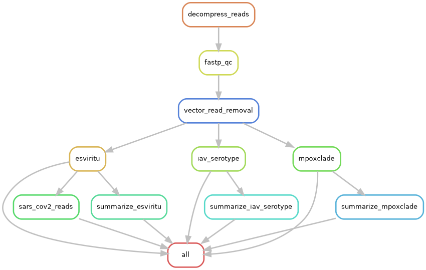

# Snakemake Virome Pipeline for TEPHI Wastewater Data

**Latest Version: 0.1.6**

A Snakemake pipeline for processing hybrid capture virome sequencing data. This pipeline decompresses sequencing reads and runs `EsViritu` for viral detection and profiling. Also runs `iav_serotype`, `mpoxclade`, and extracts SARS-CoV-2 reads for later analyses.

## Overview

The pipeline performs preprocessing, broad viral detection, and virus-specific analyses:

### Preprocessing
1. **Decompression** — Decompresses `.gz` or `.bz2` compressed FASTQ files using multi-threaded tools (`pigz`/`pbzip2`)
2. **Quality Filtering** — Filters reads with `fastp` for quality control
3. **Vector Removal** — Removes vector/adapter reads using `vrr`

### Viral Detection
4. **EsViritu** — Broad viral detection, taxonomic profiling, and coverage analysis

### Virus-Specific Modules
5. **iav_serotype** — Influenza virus serotype classification using competitive alignment
6. **mpoxclade** — Monkeypox virus clade classification
7. **SARS-CoV-2 Reads** — Extraction of SARS-CoV-2 reads from EsViritu alignments (can be used for e.g. `freyja`)

### Rule Graph of pipeline



## Requirements

- **Snakemake** ≥ 8.0
- **Conda/Mamba** for environment management
- **SLURM** (optional, for HPC execution)

### Snakemake Installation

```bash
# Create a snakemake environment
conda create -n smk_tephi_virome -c conda-forge snakemake pandas

# For SLURM support, also install:
pip install snakemake-executor-plugin-cluster-generic
```

## How to run a TEPHI pool

**TIP**: Do not run this `snakemake` command from the snakemake repo directory. Permissions will be read/execute only in this repo to improve reproducibility.

1. Run the helper script to convert CMMR standard SampleListRaw to required sample_sheet.tsv format. Includes `--path-replace` to update old cluster paths.
```bash
python scripts/prepare_sample_sheet.py /path/to/SampleListRaw pool_sample_sheet.tsv --path-replace "/gpfs1/projects:/data/service"
```

2. Customize the config or config file for your pool and run `snakemake` on the terminal.
- OPTION 1 - (Custom config file): copy `config/config.yaml` to your desired output, and manually edit
    - Change `pool_id`, `sample_sheet`, `output_root` (use absolute path)
    - Run the snakemake command to process the pool:
```bash
snakemake --snakefile /path/to/smk_tephi_virome/workflow/Snakefile\
  --configfile /path/to/pool/config.yaml\
  --profile /path/to/smk_tephi_virome/workflow/profiles/slurm ## uses cluster jobs
```

- OPTION 2 **PREFERRED**- (override config file on terminal). Run the snakemake command to process the pool:

```bash
snakemake --snakefile /path/to/smk_tephi_virome/workflow/Snakefile\
  --configfile /path/to/smk_tephi_virome/config/config.yaml\
  --config pool_id="p9999" sample_sheet="/path/to/pool/sample_sheet.tsv" output_root="/path/to/pool" ## not in snakemake directory!
  --profile /path/to/smk_tephi_virome/workflow/profiles/slurm ## uses cluster jobs
```

Variation with node exclusion. 'slurm_extra' can also be used to shoehorn in other slurm flags:

```bash
snakemake --snakefile /path/to/smk_tephi_virome/workflow/Snakefile\
  --configfile /path/to/smk_tephi_virome/config/config.yaml\
  --config pool_id="p9999" sample_sheet="/path/to/pool/sample_sheet.tsv" output_root="/path/to/pool" ## not in snakemake directory!
  --profile /path/to/smk_tephi_virome/workflow/profiles/slurm\
  --default-resources slurm_extra="--exclude=cmp02,cmp03"
```

## Directory Structure

```
smk_tephi_virome/
├── config/
│   └── config.yaml           # Pipeline configuration
├── workflow/
│   ├── Snakefile             # Main pipeline definition
│   ├── scripts/
│   │   └── extract_sars_cov2_reads.py  # SARS-CoV-2 read extraction
│   ├── envs/
│   │   ├── preprocess.yaml   # Conda env for decompression/fastp/vrr
│   │   ├── esviritu.yaml     # Conda env for EsViritu
│   │   ├── iav_serotype.yaml # Conda env for IAV serotype
│   │   ├── mpoxclade.yaml    # Conda env for mpoxclade
│   │   └── sars_cov2.yaml    # Conda env for SARS-CoV-2 extraction
│   └── profiles/
│       ├── slurm/
│       │   └── config.yaml   # SLURM cluster profile
│       └── local/
│           └── config.yaml   # Local execution profile
├── example_data/
│   └── p2026_ex_sample_sheet.tsv  # Example sample sheet
└── README.md
```

## Configuration

Edit `config/config.yaml` to set up your run:

```yaml
# Required inputs
pool_id: "p2026"                                    # Pool identifier (combined with Sample_ID for unique naming)
sample_sheet: "example_data/p2026_ex_sample_sheet.tsv"  # Path to sample sheet
esviritu_db: "/path/to/EsViritu/DBs/v3.2.4"        # Path to EsViritu database
vector_fasta: "resources/vector_sequences.fasta"   # Path to vector sequences for read removal

# Virus-specific database paths
iav_serotype_db: "/path/to/iav_serotype/liteDB_v1.1"  # IAV serotype database
mpoxclade_db: "/path/to/mpoxclade/v2.1"               # Mpoxclade database

# Output directories
output_root: "results"    # Root output directory

# Resource allocation (threads and memory in MB)
decompress_threads: 8
fastp_threads: 16
vrr_threads: 8
esviritu_threads: 8
iav_serotype_threads: 8
mpoxclade_threads: 8
sars_cov2_threads: 4
```

## Sample Sheet Format

Create a **tab-separated** sample sheet with the following columns:

| Column | Description |
|--------|-------------|
| `Sample_ID` | Unique sample identifier |
| `forward_read` | Full path to R1 FASTQ file (compressed) |
| `reverse_read` | Full path to R2 FASTQ file (compressed) |
| `read_compression` | Compression type: `gz` or `bz2` |
| `category` | Sample category: `sample` or `control` |

### Example

```tsv
Sample_ID	forward_read	reverse_read	read_compression	category
DSVHGN	/data/fastqs/DSVHGN_R1.fastq.bz2	/data/fastqs/DSVHGN_R2.fastq.bz2	bz2	sample
ZAQGLL	/data/fastqs/ZAQGLL_R1.fastq.bz2	/data/fastqs/ZAQGLL_R2.fastq.bz2	bz2	sample
NHC_Control	/data/fastqs/NHC_R1.fastq.bz2	/data/fastqs/NHC_R2.fastq.bz2	bz2	control
```

## Usage

### Dry Run (Recommended First Step)

Always perform a dry run to verify the pipeline configuration:

```bash
# Activate snakemake environment
conda activate smk_tephi_virome

# Dry run to see what jobs will be executed
snakemake --snakefile workflow/Snakefile --configfile config/config.yaml -n
```

### Run on SLURM Cluster

```bash
snakemake \
    --snakefile workflow/Snakefile \
    --configfile config/config.yaml \
    --profile workflow/profiles/slurm
```

### Run Locally

```bash
snakemake \
    --snakefile workflow/Snakefile \
    --configfile config/config.yaml \
    --profile workflow/profiles/local
```

### Additional Useful Options

```bash
# Specify number of concurrent jobs
snakemake ... --jobs 10

# Force re-run of all rules
snakemake ... --forceall

# Generate a DAG visualization
snakemake ... --dag | dot -Tpng > dag.png

# Run with verbose output
snakemake ... --verbose

# Unlock directory after failed run
snakemake ... --unlock
```

## Output Structure

Results are organized under the `output_root` directory (default: `results/`):

```
results/
├── temp/                           # Temporary files (auto-removed)
│   └── {category}/
│       ├── 01_decompress/          # Decompressed reads
│       ├── 02_fastp/               # Quality-filtered reads
│       └── 03_vrr/                 # Vector-removed reads
├── qc/
│   ├── fastp/{category}/           # fastp QC reports (HTML/JSON)
│   └── vrr/{category}/              # Vector read removal stats
├── esviritu/                       # EsViritu output files
│   └── {category}/esviritu_{pool_id}/
│       ├── {unique_id}.detected_virus.info.tsv
│       ├── {unique_id}.detected_virus.assembly_summary.tsv
│       ├── {unique_id}.tax_profile.tsv
│       ├── {unique_id}.virus_coverage_windows.tsv
│       └── {unique_id}.third.filt.sorted.bam
├── iav_serotype/                   # IAV serotype results
│   └── {category}/iav_{pool_id}/
│       └── {unique_id}_per_serotype_summary.tsv
├── mpoxclade/                      # Mpoxclade results
│   └── {category}/mpox_{pool_id}/
│       └── {unique_id}_per_clade_summary.tsv
├── virus_reads/                    # Extracted virus-specific reads
│   └── {category}/sars_cov2_{pool_id}/
│       ├── {unique_id}.sars_cov2.R1.fastq
│       └── {unique_id}.sars_cov2.R2.fastq
└── logs/                           # Log files for each step
    ├── 01_decompress/
    ├── 02_fastp/
    ├── 03_vrr/
    ├── esviritu/
    ├── iav_serotype/
    ├── mpoxclade/
    └── sars_cov2_reads/
```

### Output Files Description

#### EsViritu
| File | Description |
|------|-------------|
| `*.detected_virus.info.tsv` | Detailed information about detected viruses |
| `*.detected_virus.assembly_summary.tsv` | Assembly summary for detected viruses |
| `*.tax_profile.tsv` | Taxonomic profile of viral content |
| `*.virus_coverage_windows.tsv` | Coverage statistics across viral genomes |
| `*.third.filt.sorted.bam` | Filtered alignment file (used for read extraction) |

#### IAV Serotype
| File | Description |
|------|-------------|
| `*_per_serotype_summary.tsv` | Summary of influenza A serotype assignments |

#### Mpoxclade
| File | Description |
|------|--------------|
| `*_per_clade_summary.tsv` | Summary of monkeypox clade assignments |

#### Vector Read Removal
| File | Description |
|------|--------------|
| `*_primary_alignments.csv` | Statistics on reads aligned to vector sequences |

#### SARS-CoV-2 Reads
| File | Description |
|------|-------------|
| `*.sars_cov2.R1.fastq` | Forward reads aligning to SARS-CoV-2 |
| `*.sars_cov2.R2.fastq` | Reverse reads aligning to SARS-CoV-2 |

## Troubleshooting

### Common Issues

**1. Pipeline locked after failed run**
```bash
snakemake --snakefile workflow/Snakefile --configfile config/config.yaml --unlock
```

**2. Check logs for failed jobs**
```bash
# Logs are stored in results/logs/{rule}/{category}/
cat results/logs/02_esviritu/sample/SAMPLE_ID.pool_id.log
```

**3. Missing conda environments**
```bash
# Create environments before running
snakemake --snakefile workflow/Snakefile --configfile config/config.yaml --conda-create-envs-only
```

**4. SLURM job not submitting**
- Verify partition name in `workflow/profiles/slurm/config.yaml`
- Check cluster availability with `sinfo`

### Linting the Workflow

Verify workflow best practices:

```bash
snakemake --lint
```

## Pipeline Design Notes
### MJT
1. I used `snakemake-executor-plugin-cluster-generic` over `snakemake-executor-plugin-slurm` in the end. I tried `snakemake-executor-plugin-slurm` but it either does not work on our cluster or there were other issues. 
 - `snakemake-executor-plugin-cluster-generic` is somewhat inelegant with its shell commands in parentheses, but it works well to distribute the jobs on the cluster properly.
 -  I emulated the style of `notes/style/smk-simple-slurm` [https://github.com/jdblischak/smk-simple-slurm](https://github.com/jdblischak/smk-simple-slurm)

2. I'm pretty uncomfortable with snakemake as a workflow language, especially as it relates to wildcard expansion, so I relied on LLMs to get the workflow structure in place.
 - I found that GPT 5.1 codex did a bad job. It got very confused with the style and syntax of snakemake (wildcards, etc), even disbuting errors thrown by the snakemake linter.
 - Claude Opus 4.5 did MUCH better. It kind of just "gets" snakemake. This is what I used in the end.
 - I gave the LLMs a well-used snakemake workflow (`notes/style/StainedGlass`) [https://github.com/mrvollger/StainedGlass](https://github.com/mrvollger/StainedGlass) as a style guide. I think this helped a lot.

3. I think it helps a lot to pre-process the standard CMMR sample sheet into the format like `example_data/p2026_ex_sample_sheet.tsv` rather than have the snakemake pipeline do this. If the snakemake pipeline has to do this, it gets a bit complicated. I find snakemake works best for running a straightforward set of modules on a pre-defined sample sheet. Therefore, I added the helper script to convert `SampleListRaw` (scripts/prepare_sample_sheet.py).

## License

See repository license file.

## Citation

If you use this pipeline, please cite:

- **EsViritu**: [https://github.com/cmmr/EsViritu](https://github.com/cmmr/EsViritu)
- **iav_serotype**: [https://github.com/mtisza1/influenza_a_serotype](https://github.com/mtisza1/influenza_a_serotype)
- **mpoxclade**: [https://github.com/mtisza1/mpoxclade](https://github.com/mtisza1/mpoxclade)
- **vrr**: [https://github.com/mtisza1/vector_read_removal](https://github.com/mtisza1/vector_read_removal)
- **fastp**: Chen S, et al. (2018). fastp: an ultra-fast all-in-one FASTQ preprocessor. Bioinformatics.
- **Snakemake**: Mölder F, et al. (2021). Sustainable data analysis with Snakemake. F1000Research.

## To-Do
- consider pixi over conda

